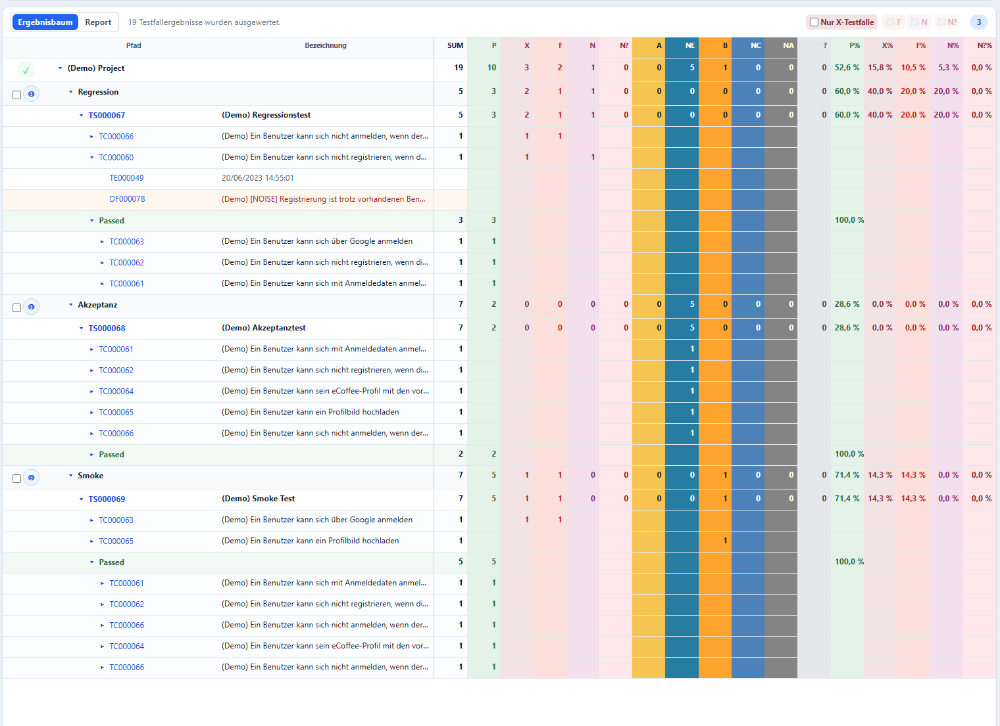
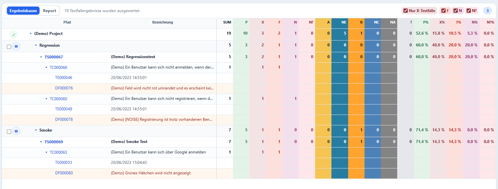
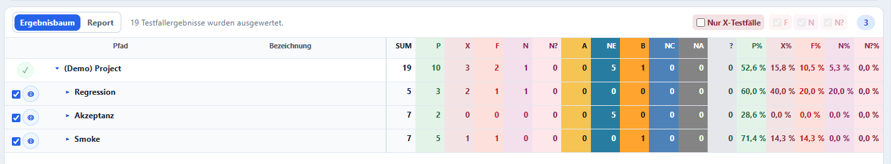
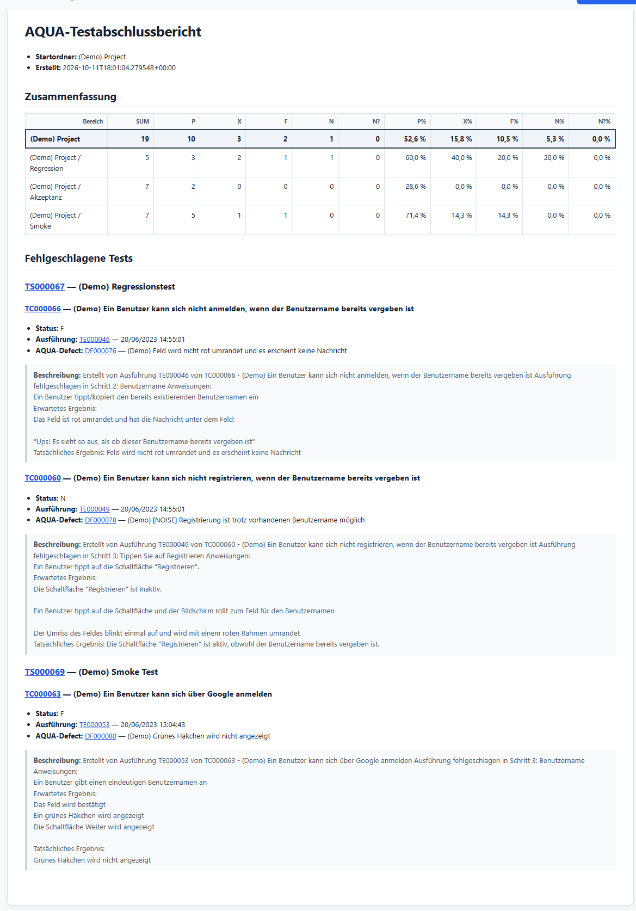

# H2ORB Kurzanleitung

H2ORB fasst Testergebnisse aus AQUA in einem aufklappbaren Baum zusammen. Fehlgeschlagene Tests,
zugehörige Ausführungen und AQUA Defects sind dadurch ohne Suche über mehrere AQUA-Seiten gemeinsam
sichtbar. Der integrierte Testabschlussbericht lässt sich als Markdown herunterladen.

H2ORB ist ein unabhängiges Open-Source-Projekt und weder mit einem Anbieter von
Testmanagementsoftware verbunden noch von einem solchen Anbieter empfohlen.

Diese Kurzanleitung beschreibt die Bedienung. Verbindliche fachliche und technische Regeln stehen
in folgenden Dokumenten:

- [Ergebnisbaum](result-tree.md): Statusermittlung, Aggregation, Filter und Darstellung
- [Report-Vertrag](report-contract.md): Umfang, Summary und Detailinhalt des Berichts
- [Security-Roadmap](security-roadmap.md): Sicherheitsanforderungen und noch offene Härtungsmaßnahmen

## Sicherheitshinweis

Jeder Benutzer meldet sich in H2ORB mit seinen persönlichen AQUA-Zugangsdaten an. Das Passwort wird
nur zur Anmeldung an AQUA verwendet und von H2ORB nicht gespeichert. AQUA-Token verbleiben in einer
kurzlebigen, serverseitigen Sitzung; der Browser erhält lediglich ein zufälliges, nicht lesbares
Sitzungs-Cookie.

- Port `8000` nicht direkt im Internet veröffentlichen.
- Einen gemeinsam genutzten Server ausschließlich über einen HTTPS-Reverse-Proxy bereitstellen und
  `ARB_SESSION_COOKIE_SECURE=true` setzen.
- Den Zugriff zusätzlich mit Firewall-Regeln begrenzen und AQUA-Benutzern nur die benötigten Rechte
  geben.
- `.env`, Passwörter, Zertifikatsschlüssel und Zugriffstoken niemals in das Image oder Repository
  aufnehmen.
- Erzeugte Berichte als potenziell vertrauliche Testdaten behandeln.

### Lokaler Einzelplatzbetrieb

Bei der Installation über PyPI läuft H2ORB lokal auf dem Arbeitsplatzrechner. Solange H2ORB
ausschließlich an `127.0.0.1` gebunden ist, verlässt die HTTP-Verbindung zwischen Browser und
H2ORB den Rechner nicht. Für diesen Einzelplatzbetrieb ist `http://127.0.0.1:8000` zulässig.

```env
ARB_HOST=127.0.0.1
ARB_ENVIRONMENT=development
ARB_SESSION_COOKIE_SECURE=false
ARB_RELOAD=false
```

`ARB_HOST` darf dabei nicht auf `0.0.0.0` geändert und Port `8000` weder freigegeben noch
weitergeleitet werden. Die Verbindung von H2ORB zu AQUA erfolgt weiterhin über HTTPS. Sobald H2ORB
von einem anderen Rechner erreichbar sein soll, ist ein HTTPS-Reverse-Proxy erforderlich und
`ARB_SESSION_COOKIE_SECURE=true` zu setzen.

## Auswertung starten

1. H2ORB im Browser öffnen und mit den persönlichen AQUA-Zugangsdaten anmelden.
2. Das gewünschte AQUA-Projekt aufklappen und den Projekt- oder Versionsordner auswählen.
3. **Auswertung starten** anklicken. H2ORB lädt Szenarien, Testfälle, letzte Ausführungen und Defects
   rekursiv.
4. Bei Bedarf auf **Report** wechseln und den Bericht als Markdown herunterladen.

## Ergebnisstatus

Die vollständige und verbindliche Statusdefinition steht im
[Vertrag für den Ergebnisbaum](result-tree.md#ergebnisermittlung). Für die Bedienung sind vor allem
folgende Status relevant:

| Kürzel | Bedeutung | Verwendung |
| --- | --- | --- |
| P | Passed | Testfall erfolgreich ausgeführt |
| X | Failed gesamt | Abgeleitete Summe aus F, N und N? |
| F | Defect | Fehlgeschlagen und mit einem regulären AQUA Defect verknüpft |
| N | Noise | Fehlgeschlagen und mit einem als `NOISE` markierten AQUA Defect verknüpft |
| N? | Ungeklärt | Fehlgeschlagen, aber noch ohne verknüpften AQUA Defect |
| NE | Not Executed | Noch nicht ausgeführt, wartend oder eingeplant |

## Ergebnisbaum

Ordner und Testszenarien zeigen die aufsummierten Resultate ihrer untergeordneten Testfälle. Die
Kennungen von Testszenarien, Testfällen, Testausführungen und Defects sind direkt mit der jeweiligen
AQUA-Seite verlinkt. Erfolgreiche Testfälle werden je Szenario unter **Passed** gesammelt und können
gemeinsam ein- oder ausgeklappt werden.



## Fehlgeschlagene Tests untersuchen

Mit **Nur X-Testfälle** blendet H2ORB erfolgreiche Testfälle aus und öffnet die Pfade zu den
fehlgeschlagenen Tests. Die Schalter **F**, **N** und **N?** grenzen die Anzeige anschließend auf die
gewünschte Fehlerklasse ein.

- **F** zeigt Testfälle mit regulärem AQUA Defect.
- **N** zeigt Testfälle mit einem Defect, dessen Bezeichnung den Marker `NOISE` enthält.
- **N?** zeigt fehlgeschlagene Testfälle, denen noch kein AQUA Defect zugeordnet ist.



## Zusammenfassung für den Bericht auswählen

Das gewählte Wurzelverzeichnis erscheint immer als hervorgehobenes Gesamtergebnis. Zusätzliche
Ordner lassen sich über die Kontrollkästchen in die Zusammenfassung aufnehmen. Die Auswahl ändert nur
den Report und nicht die berechneten Ergebnisse.



## Testabschlussbericht

Der Report enthält die Gesamtwerte und die optional ausgewählten Ordner. Im Detail erscheinen nur
fehlgeschlagene Tests mit Status, letzter Ausführung, verknüpftem AQUA Defect und dessen Beschreibung.
Alle Kennungen führen direkt zur passenden Seite in AQUA.



## Installation mit pip

Python 3.12 oder neuer wird benötigt:

```powershell
py -m pip install h2orb
h2orb
```

Nach der Konfiguration der benötigten `ARB_`-Umgebungsvariablen ist H2ORB unter
<http://127.0.0.1:8000> erreichbar.

## Container starten

Zuerst eine lokale `.env` anhand von `.env.example` erstellen. Anschließend das veröffentlichte
`linux/amd64`-Image laden und starten:

```powershell
docker pull hrabovszki/h2orb:0.2.0
docker run --detach --name h2orb `
  --restart unless-stopped `
  --env-file .env `
  --env ARB_HOST=0.0.0.0 `
  --publish 8000:8000 `
  hrabovszki/h2orb:0.2.0
```

Für reproduzierbare Installationen sollte ein fester Versions- oder `sha-*`-Tag verwendet werden.
Aktuelle Befehle und Konfigurationsoptionen stehen in der [Projekt-README](../README.md#docker).
